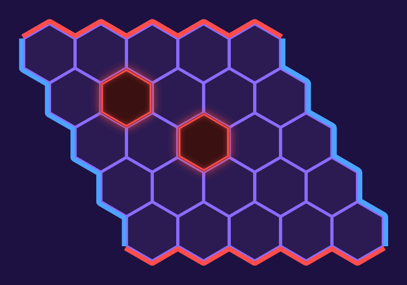
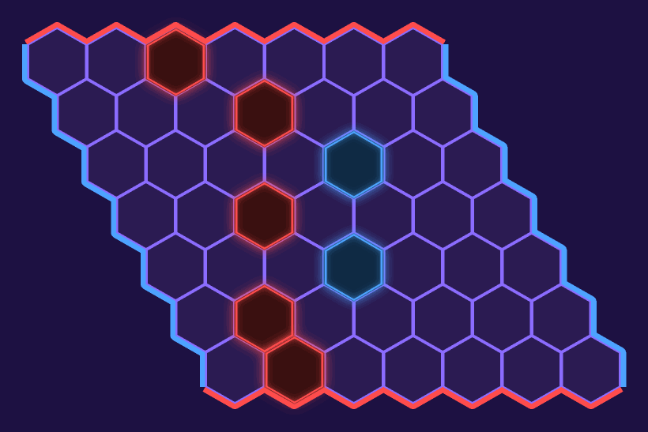

# Nuestros bots

Todos los bots están en [`src/hexarena/bots/`](https://github.com/monianzola/HEX/tree/main/src/hexarena/bots), un archivo por bot. Se registran solos, así que **aparecen automáticamente** en el selector de rivales de la [web](https://hex-arena-cunef.streamlit.app) y en el [torneo](https://monianzola.github.io/HEX/).

| Bot | Técnica (temario) | Cómo decide |
|---|---|---|
| 🎲 **RandomBot** | — | Una casilla libre al azar. Es la referencia mínima. |
| 📏 **ShortestPathBot** | Heurística + *greedy* | Prueba cada jugada y se queda con la mejor según el camino más corto. Mira **una** jugada. |
| 🧠 **AlphaBetaBot** | *Maximin* (minimax) + **poda alfa-beta** | Mira **varias** jugadas adelante, suponiendo que el rival responde lo mejor posible. |
| 🌉 **BridgeBot** | AlphaBeta + BFS con «saltos» | La misma búsqueda que AlphaBeta, con una heurística que entiende los **puentes**. |
| 🧤 **Portero** *(enviado por otro equipo)* | Heurística | Gana si puede; si no, se pone en el camino más corto del rival por donde también avanza él. |

La clasificación actual está en **[monianzola.github.io/HEX](https://monianzola.github.io/HEX/)** y se actualiza sola con cada cambio. Las técnicas de cada bot están explicadas abajo y, con más detalle técnico, en la [referencia del API](api/bots.md).

---

## La idea común: el camino más corto

Casi todos los bots se basan en una pregunta: **¿cuántas fichas le faltan a cada jugador para unir sus dos bordes?**

Es un **camino mínimo** en un grafo: cada casilla es un nodo y sus 6 vecinas, las aristas. Pasar por una casilla cuesta:

| Casilla | Coste |
|---|---|
| Ficha propia | 0 (ya está puesta) |
| Vacía | 1 (hay que poner una ficha) |
| Ficha del rival | no se puede pasar |

Como los costes solo valen 0 o 1, se calcula con **0-1 BFS**: un Dijkstra simplificado con una cola doble. Las casillas de coste 0 se meten al principio de la cola y las de coste 1 al final.

La **evaluación** de una posición es **fichas que le faltan al rival − fichas que me faltan a mí**: cuanto más alta, mejor para mí. Una misma jugada puede servir para **avanzar** (baja lo que me falta) y para **bloquear** (sube lo que le falta al rival).

---

## 🎲 RandomBot

Juega una casilla libre al azar. No es un rival serio: sirve para comprobar que cualquier otro bot es mejor que el azar, y como **plantilla** del bot más sencillo posible.

## 📏 ShortestPathBot (greedy)

1. Para cada casilla libre, imagina que juega ahí.
2. Calcula la evaluación (*rival − propio*).
3. Juega la de mejor evaluación; si empatan, la más cercana al centro.

Es rápido (menos de 0,1 s por jugada), pero **solo mira una jugada**: no anticipa la respuesta del rival.

## 🧠 AlphaBetaBot (maximin con poda alfa-beta)

**Maximin:** elige la jugada cuyo **peor caso** es el mejor, suponiendo que el rival responde siempre lo mejor posible. Mira varias jugadas hacia delante (un árbol de jugadas y respuestas) y evalúa las posiciones del final con la heurística del camino más corto.

**Poda alfa-beta:** mientras busca, recuerda lo mejor que ya tiene asegurado cada jugador. Si una rama ya es peor que algo que tenía, el rival nunca le dejaría llegar a ella, así que **deja de mirarla**. El resultado es el mismo que sin poda, pero mirando muchas menos posiciones (un test lo comprueba).

Tres decisiones para que quepa en el tiempo:

- **Profundización iterativa:** busca a 1, 2, 3… jugadas hasta agotar el 80 % del tiempo, y siempre tiene una respuesta lista.
- **Solo 20 candidatos por nodo:** las casillas más cercanas a los caminos más cortos de los dos jugadores.
- **Ordenación:** mira primero las jugadas más prometedoras, así la poda corta más.

En 1 segundo llega a 3–4 jugadas de profundidad en 7×7.

## 🌉 BridgeBot (alfa-beta + puentes)

Un **puente** son dos fichas tuyas que **no son vecinas pero comparten dos casillas vecinas libres**. El rival no puede cortarlo: si juega en una de esas dos casillas, tú juegas en la otra.

{ width="420" }

*Puente rojo: las dos fichas comparten dos casillas libres. Si Azul ocupa una, Rojo ocupa la otra.*

BridgeBot usa **la misma búsqueda que AlphaBeta**; solo cambia la heurística. Al calcular el camino más corto, desde cada casilla también puede **saltar al otro extremo de un puente** como si fueran vecinas.

{ width="520" }

*Cadena de puentes rojos de arriba abajo. Sin contar puentes, al Rojo le faltan 3 fichas; contándolos, le faltan 0: ya está conectado «virtualmente».*

## 🧤 Portero (enviado por otro equipo)

Lo enviaron Antonio Orteu, María Sanz y Álvaro Domingo siguiendo nuestro [tutorial](tutorial-bot.md), y lo revisamos antes de aceptarlo (ver [Contribuir](contribuir.md#como-revisamos-un-pr-de-bot)). No busca hacia delante: es una **heurística de dos reglas**.

1. **Ganar:** si una ficha le hace ganar, la pone.
2. **Cortar al rival:** entre las casillas que están en un camino más corto del rival, juega la que más le acerca a su propio camino; si empatan, la más centrada.

---

## Resultados medidos

Con aperturas aleatorias y jugando con los dos colores, 20 partidas por enfrentamiento (0,5 s por jugada en nuestras pruebas):

| Enfrentamiento | Resultado |
|---|---|
| AlphaBetaBot contra ShortestPathBot (7×7) | AlphaBeta gana el **85 %** |
| BridgeBot contra ShortestPathBot (7×7) | Bridge gana el **90 %** |
| BridgeBot contra AlphaBetaBot (7×7) | **45 %**: igualados |
| BridgeBot contra AlphaBetaBot (9×9) | Bridge gana el **60 %**: los puentes ayudan más en tableros grandes |
| Portero contra ShortestPath / AlphaBeta / Bridge | 13/20, 5/20 y 4/20 (según su autor, 1 s por jugada) |

!!! info "¿Cuál es el mejor?"
    **AlphaBetaBot y BridgeBot están igualados en 7×7.** En los torneos, el orden entre los dos cambia de un día a otro (11–9 para uno, 11–9 para el otro), porque su profundidad de búsqueda depende de la velocidad de la máquina. En tableros grandes, BridgeBot sale algo por delante.

!!! note "¿Por qué no hay un bot MCTS?"
    Tuvimos un bot de Monte Carlo Tree Search, pero lo quitamos porque no forma parte del temario de la asignatura. Preferimos bots que podemos explicar enteros: heurística, greedy, minimax/maximin y poda alfa-beta.

¿Quieres que tu bot aparezca aquí? Sigue el [tutorial](tutorial-bot.md).
