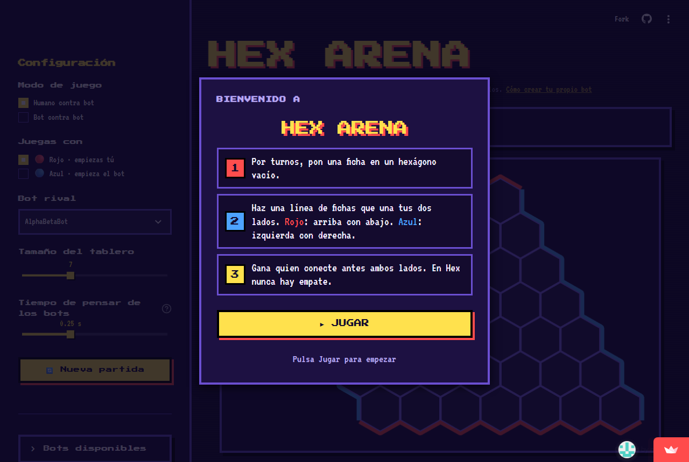
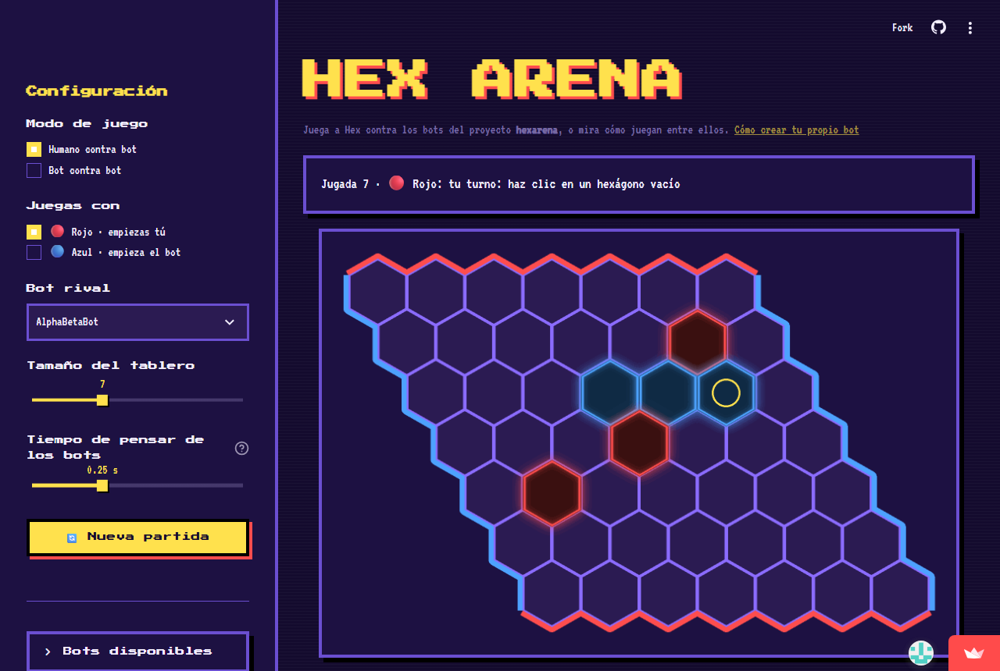

# La web

▶ **[hex-arena-cunef.streamlit.app](https://hex-arena-cunef.streamlit.app)**: se juega en el navegador, sin instalar nada. Funciona también en el móvil.

## Al entrar

La primera vez que entras sale una ventana que explica el objetivo del juego en tres pasos. Pulsa **► JUGAR** para empezar (también puedes llegar al botón con `Tab` y pulsar `Enter`). Solo sale una vez por visita: no vuelve a aparecer al jugar ni con «Nueva partida».



## Jugar contra un bot



1. En la barra lateral, elige **«Humano contra bot»**.
2. Elige tu color en **«Juegas con»**:
    - 🔴 **Rojo**: empiezas tú y unes el borde **de arriba** con el **de abajo**.
    - 🔵 **Azul**: empieza el bot, y tú unes la **izquierda** con la **derecha**.
3. Elige el **bot rival** (ver [Nuestros bots](bots.md)).
4. Haz clic en un **hexágono vacío** para poner tu ficha. El bot responde enseguida.

Qué significa lo que ves en el tablero:

| En el tablero | Significado |
|---|---|
| Bordes rojos arriba y abajo, azules a los lados | Los lados que tiene que unir cada color |
| Ficha con brillo rojo o azul | Ficha de cada jugador |
| Aro amarillo dentro de una ficha | La **última jugada** |
| Fichas con hexágono amarillo al acabar | La **cadena ganadora** |

El recuadro de arriba indica de quién es el turno y, al acabar, quién ha ganado.

## Opciones

| Opción | Para qué sirve |
|---|---|
| **Tamaño del tablero** (5 a 11) | Tableros pequeños = partidas cortas; grandes = más estrategia |
| **Tiempo de pensar de los bots** (0,1 a 1 s) | Con menos tiempo responden más rápido; con más, juegan mejor. El torneo usa 1 s |
| **↩️ Deshacer mi última jugada** | Quita tu última ficha y la respuesta del bot |
| **🔄 Nueva partida** | Empieza otra partida con las opciones elegidas |
| **Historial** | Lista de todas las jugadas de la partida |
| **Bots disponibles** | Descripción de cada bot |

Cambiar el tamaño, el color o el bot empieza una partida nueva.

## Bot contra bot

1. Elige **«Bot contra bot»** en la barra lateral.
2. Elige el **bot Rojo** y el **bot Azul**.
3. Pulsa **⏭️ Siguiente jugada** para ver la partida paso a paso, o **▶️ Jugar automáticamente** para verla entera (con ⏸️ Pausar).

Es una buena forma de entender cómo juega cada bot.

## Si un bot falla

Si un bot lanza un error o hace una jugada ilegal, **pierde la partida** y la web te lo indica. La página no se rompe.

## Ejecutarla en tu ordenador

```bash
pip install -e ".[web]"
streamlit run app/app.py
```

Se abre en `http://localhost:8501`. El código de la web está en [`app/`](https://github.com/monianzola/HEX/tree/main/app): `app.py` (la página), `game_controller.py` (la partida, sin Streamlit), `board_render.py` (el dibujo del tablero) y `theme.py` / `welcome.py` (el estilo).
